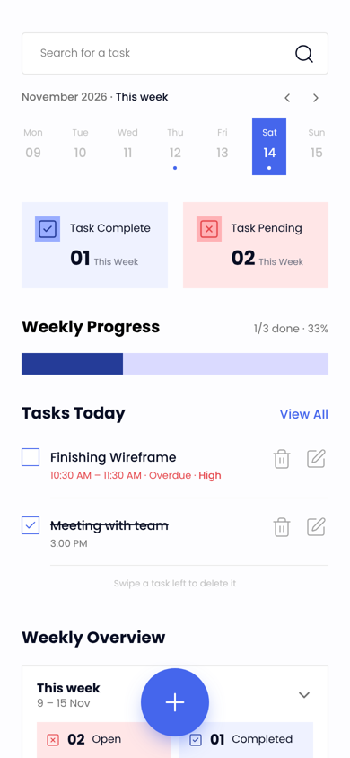
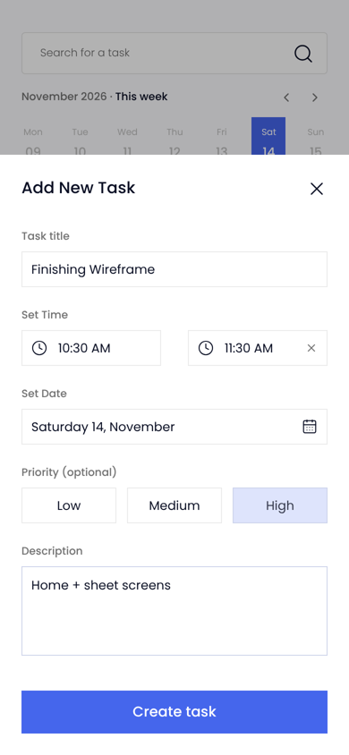
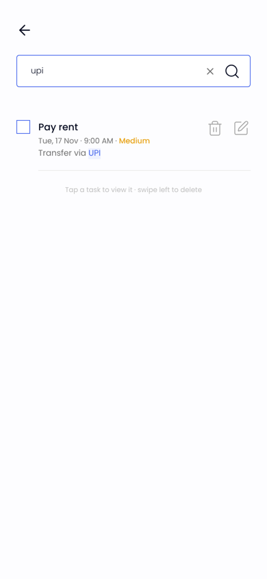
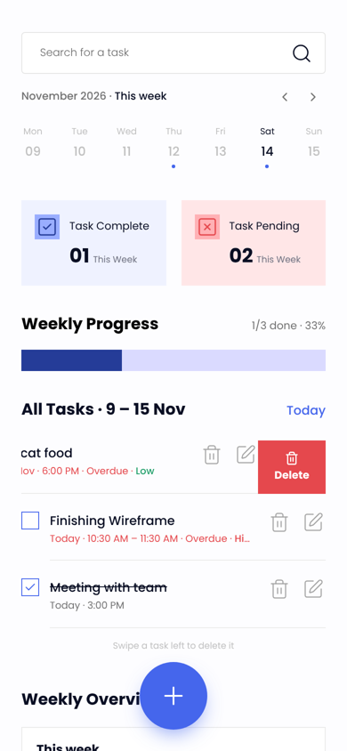
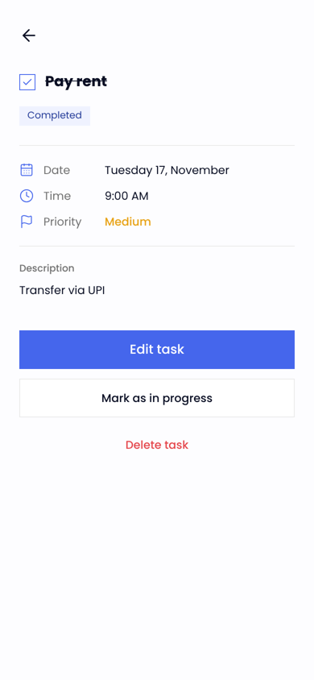
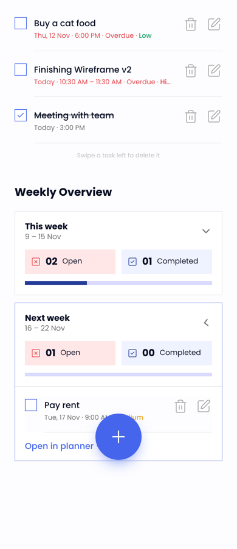
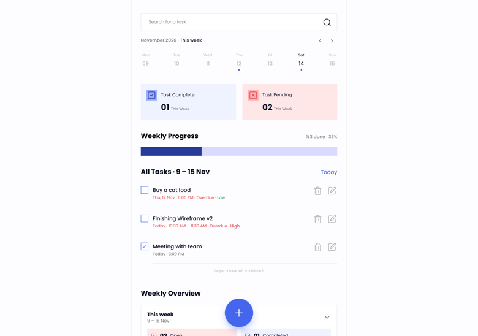

# To-Do List — Weekly Planner (MERN)

A mobile-first to-do app that groups your tasks into **Monday → Sunday weeks** and shows open vs. completed counts for each one. The UI follows the provided Figma design. The data comes from the app's own REST API (Express + MongoDB).

**Live demo:** https://your-site.netlify.app &nbsp;·&nbsp; **API:** https://your-api.onrender.com/api/health

> The API runs on Render's free tier, which sleeps when idle. The first request after a break can take 30–50 seconds; the app shows a "waking up the server" message while it starts.

<p align="center">
  
  
  
</p>

## Tech stack

| Layer | Tools |
| --- | --- |
| Frontend | React 19, TypeScript, Vite 8, Tailwind CSS v4, React Router 7, TanStack Query 5, React Hook Form + Zod, date-fns, Sonner, Lucide icons |
| Backend | Node.js 22, Express 5, Mongoose 9, Zod 4, Helmet, CORS, express-rate-limit |
| Database | MongoDB Atlas (free cluster) |
| Testing | Vitest + Supertest (17 API tests) |
| Hosting | Netlify (frontend) · Render (API) · MongoDB Atlas (database) |

## Features

| Requirement | How it works |
| --- | --- |
| **Create a task**: title\*, description, date & time\*, priority | Tap **+** to open the **Add New Task** bottom sheet from the Figma. Priority (Low / Medium / High) is optional; tap it again to clear it. There's also an optional **Ends** time, as in the design. |
| **Edit any attribute** | Tap a task or its edit icon. The same sheet opens pre-filled, and status can be changed there too. |
| **Delete** | **Swipe a task left → Delete**, tap the trash icon, or use "Delete task" in the sheet. Every delete shows an **Undo** toast. |
| **Search** by keyword | Searches title and description on the server as you type, and highlights the matches. Each result can be viewed, edited or deleted. |
| **Weeks run Monday → Sunday** | The server groups tasks **in the user's time zone**, so a task late on Sunday night stays in the right week. |
| **Weekly summary cards** | **Task Complete / Task Pending** cards and a **Weekly Progress** bar for the selected week. **Weekly Overview** has one card per week; tap it to see that week's tasks. |
| **Mark Completed / In Progress** | A checkbox on every task. The counts update instantly (optimistic update), then sync with the server. |
| **Responsive** | Built from the 390 px Figma frames. On tablets and desktops it becomes a centred column, and the form turns into a centred dialog. |

Also included: a day strip that filters by day and moves between weeks with ‹ ›, an onboarding screen on the first visit, loading skeletons, keyboard and screen-reader support (Esc closes the sheet), and `prefers-reduced-motion` support.

<details>
<summary><b>More screenshots</b></summary>
<br />
<p align="center">
  
  
  
  
</p>
<p align="center">
  
</p>
</details>

## Project structure

```
todo-app/
├── client/                  React app (deploys to Netlify)
│   ├── src/
│   │   ├── pages/           Home, Search, TaskForm (bottom sheet), TaskDetail, Onboarding
│   │   ├── components/      TaskItem, SwipeableRow, day strip, summary & week cards
│   │   ├── hooks/           useTasks.ts: React Query queries + optimistic mutations
│   │   ├── lib/             api.ts (axios), dates.ts (week maths), types.ts
│   │   └── index.css        Design tokens taken from the Figma (colours, Poppins, borders)
│   └── netlify.toml
├── server/                  Express API (deploys to Render)
│   ├── src/
│   │   ├── routes/          HTTP endpoints + Zod validation
│   │   ├── services/        Business rules: 404s, end-time checks, weekly summary
│   │   ├── repositories/    MongoDB (Mongoose) and in-memory storage, same interface
│   │   ├── utils/week.js    Time-zone-aware Monday→Sunday grouping
│   │   └── middleware/      Error handling
│   └── tests/               Vitest + Supertest
├── docs/screenshots/
└── render.yaml
```

## Run it locally

**Requirements:** Node **22.12 or newer** (`node -v`) and npm.

### 1. Start the API

```bash
cd server
npm install
cp .env.example .env      # Windows PowerShell: copy .env.example .env
npm run dev               # http://localhost:5000
```

`server/.env` options:

| Variable | Required | Example | What it does |
| --- | --- | --- | --- |
| `MONGODB_URI` | No, locally | `mongodb+srv://<user>:<password>@<cluster>.mongodb.net/TODO_APP_DB?retryWrites=true&w=majority` | Your database. **Leave it empty to use in-memory storage**, which needs no setup but resets on restart. |
| `PORT` | No | `5000` | API port. |
| `CORS_ORIGIN` | No | `https://your-site.netlify.app` | Comma-separated list of sites allowed to call the API. Empty = allow all. |
| `DNS_SERVERS` | No | `8.8.8.8,1.1.1.1` | Use this only if you see `querySrv ECONNREFUSED`; see Troubleshooting. |

With a database connected you should see:

```text
✓ Connected to MongoDB
✓ API listening on http://localhost:5000
```

### 2. Start the web app (second terminal)

```bash
cd client
npm install
npm run dev               # http://localhost:5173 (API calls are proxied to :5000)
```

### 3. Run the tests

```bash
cd server
npm test                  # 17 passing; uses in-memory storage, no database needed
```

### Using MongoDB Atlas locally

1. In Atlas, create a free cluster and a database user (letters and numbers only in the password), and add `0.0.0.0/0` under **Network Access**.
2. Copy the connection string from **Connect → Drivers**, and add the database name after `.net/`, for example `/TODO_APP_DB`.
3. Put it in `server/.env` as `MONGODB_URI=...`.

The `tasks` collection is created automatically when you add your first task.

## API

Base URL: `/api`. Success returns `{ "data": ... }`. Errors return `{ "error": "...", "details"?: [...] }` with status 400 (validation) or 404 (not found).

| Method | Endpoint | Body / query |
| --- | --- | --- |
| `GET` | `/tasks` | `?search=&from=&to=&status=` (ISO dates; `from` inclusive, `to` exclusive) |
| `GET` | `/tasks/summary/weekly` | `?tz=Asia/Kolkata` → `{ timeZone, weeks: [{ weekKey, weekStart, weekEnd, total, open, completed }] }` |
| `GET` | `/tasks/:id` | |
| `POST` | `/tasks` | `{ title*, dueDate*, endsAt?, description?, priority?: "low" \| "medium" \| "high" \| null, status?: "in_progress" \| "completed" }` |
| `PATCH` | `/tasks/:id` | any of the fields above |
| `PATCH` | `/tasks/:id/status` | `{ status }` |
| `DELETE` | `/tasks/:id` | returns `204 No Content` |
| `GET` | `/health` | `{ "status": "ok" }` |

Example:

```bash
curl -X POST http://localhost:5000/api/tasks \
  -H "Content-Type: application/json" \
  -d '{"title":"Finish wireframes","dueDate":"2026-11-16T10:30:00+05:30","priority":"high"}'
```

## How it's built

- **Layered API:** routes → service → repository. Routes validate input with Zod. The service holds the business rules. The repository is the only code that touches storage, and the in-memory version lets the tests run without a database.
- **Weeks in the user's time zone:** the client sends its IANA time zone. The server works out each task's Monday with `date-fns` + `@date-fns/tz`, then counts open and completed tasks per week.
- **Fast UI:** TanStack Query caches responses. Toggling a status or deleting a task updates the screen immediately, rolls back if the request fails, then refetches so the counts match the server.
- **The form as a bottom sheet with its own URL:** `/tasks/new` and `/tasks/:id/edit` render as a sheet over the current screen (React Router's background-location pattern). Refreshing the page keeps the screen behind the sheet.
- **State in the URL:** the selected week, day and expanded card live in the query string, so Back, Refresh and shared links all land on the same view.
- **Validation on both sides:** the client gives instant feedback, and the server rejects bad input regardless. That includes an end time before its start, even when only one of the two is updated.
- **Security basics:** Helmet headers, a CORS allow-list, rate limiting (300 requests/min), a 100 KB body limit, and escaped regex search.

## Deployment (free)

1. **Database: MongoDB Atlas.** Create a free cluster and a database user, and allow `0.0.0.0/0` (Render's free tier has no fixed IP).
2. **API: Render.** Choose **New → Web Service** with Root Directory `server`, Build `npm install`, Start `npm start` and the Free instance. Add environment variables `NODE_ENV=production`, `MONGODB_URI=<atlas string>` and `CORS_ORIGIN=<netlify url>`. Check that `/api/health` returns `{"status":"ok"}`.
3. **Frontend: Netlify.** Import the repo with Base directory `client`. The build settings come from `client/netlify.toml`. Add `VITE_API_URL=https://<your-api>.onrender.com/api`, then deploy.

Every push to `main` redeploys both automatically. `VITE_API_URL` is baked in at build time, so after changing it, run **Trigger deploy → Clear cache and deploy site** on Netlify.

## Troubleshooting

| Problem | Fix |
| --- | --- |
| `querySrv ECONNREFUSED _mongodb._tcp...` locally | Your router or ISP blocks the DNS lookups that `mongodb+srv://` needs. Add `DNS_SERVERS=8.8.8.8,1.1.1.1` to `server/.env` and restart with Ctrl+C → `npm run dev` (`--watch` doesn't reload `.env`). Not needed on Render. |
| `bad auth` / `Authentication failed` | Wrong user or password in `MONGODB_URI`. Reset it in Atlas → Database Access. |
| Connection timeout to Atlas | Add `0.0.0.0/0` (or your IP) in Atlas → Network Access. |
| App shows "Couldn't load your tasks" | Check `VITE_API_URL` ends in `/api`, then redeploy Netlify with a cleared cache. |
| Browser console: `blocked by CORS policy` | `CORS_ORIGIN` must match the site URL exactly: `https://`, no trailing slash. |
| First load takes ~50 seconds | Render's free tier was asleep. This is expected. |

## Design notes

- Tokens in `client/src/index.css` come from the Figma file: Poppins, `#4566EC` primary, `#253C98` / `#DADAFF` progress bar, `#EFF2FF` / `#FFE6E7` summary cards, square corners.
- Icons are from Lucide, the maintained fork of Feather. The Figma's icon layers are Feather icons (`edit`, `trash-2`, `search`, `plus`). The onboarding shapes are redrawn as inline SVG.
- The brief asks for things the Figma doesn't show: expandable week cards, priority, task status, a task view and swipe-to-delete. They're built from the same tokens so they match the rest of the design.